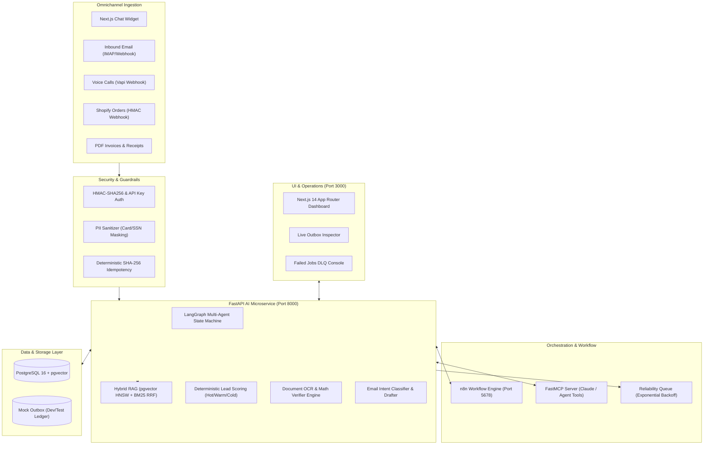

# LeadPilot AI — AI Business Automation Hub

[](https://www.python.org/downloads/release/python-3120/)
[](https://nodejs.org/)
[](https://opensource.org/licenses/MIT)
[](docs/ARCHITECTURE.md)
[](services/ai/tests)
[](docs/RAG_EVAL.md)

> **LeadPilot AI** is a production-grade, enterprise-ready AI business automation platform that functions as a virtual AI operations team for mid-market service businesses. Configured out-of-the-box for **BrightSmile Dental** (a synthetic demo tenant), LeadPilot AI unifies customer support RAG chat with verified citations, automated lead scoring and CRM synchronization, intelligent email triage and draft review, mathematical invoice extraction, voice call transcript summarization, and Shopify e-commerce order fulfillment — backed by a state-of-the-art Next.js 14 management dashboard and FastMCP Model Context Protocol integration.

---

## 🏗️ Architecture Overview



---

## 🎯 The Hiring Matrix

This repository is engineered to directly prove mastery across all technical competencies required by enterprise clients:

| Client Requirement | How LeadPilot AI Demonstrates Mastery | Relevant Files |
| :--- | :--- | :--- |
| **Multi-Agent Orchestration** | Cyclic state machine with explicit routing, tool execution, and clinical human handoff banners. | [`services/ai/app/agent/graph.py`](file:///d:/AI-BUSINESS-AUTOMATION/leadpilot-ai/services/ai/app/agent/graph.py) |
| **High-Precision RAG** | Hybrid retrieval combining pgvector dense cosine search with BM25 keyword matching via Reciprocal Rank Fusion (**90.0% Recall@5**). | [`services/ai/app/rag/retriever.py`](file:///d:/AI-BUSINESS-AUTOMATION/leadpilot-ai/services/ai/app/rag/retriever.py) |
| **Workflow Automation (n8n)** | 8 production-grade n8n workflow JSONs covering chat gateways, lead routing, voice call reconciliation, and scheduled reports. | [`n8n/workflows/`](file:///d:/AI-BUSINESS-AUTOMATION/leadpilot-ai/n8n/workflows/) |
| **Model Context Protocol (MCP)** | Dual-mode FastMCP server exposing 5 tools for Claude Desktop and agentic tools via stdio and SSE transports. | [`services/mcp/server.py`](file:///d:/AI-BUSINESS-AUTOMATION/leadpilot-ai/services/mcp/server.py) |
| **Webhook Security & PII** | Constant-time HMAC-SHA256 signature verification, API keys, deterministic idempotency, and automated regex PII masking. | [`services/ai/app/security.py`](file:///d:/AI-BUSINESS-AUTOMATION/leadpilot-ai/services/ai/app/security.py) |
| **OCR & Math Verification** | Multi-line PDF extraction with strict line-item math verification (`qty * unit_price == total` within $0.05 tolerance). | [`services/ai/app/features/extraction.py`](file:///d:/AI-BUSINESS-AUTOMATION/leadpilot-ai/services/ai/app/features/extraction.py) |
| **Enterprise Reliability** | Dead-letter queues with exponential backoff (1s, 2s, 4s), jitter, and UI-driven manual retry controls. | [`services/ai/app/jobs/retry.py`](file:///d:/AI-BUSINESS-AUTOMATION/leadpilot-ai/services/ai/app/jobs/retry.py) |
| **Modern Web Dashboard** | Next.js 14 App Router, TypeScript, Tailwind CSS, 12 production routes, dark-mode glassmorphism styling. | [`web/src/app/`](file:///d:/AI-BUSINESS-AUTOMATION/leadpilot-ai/web/src/app/) |

---

## ⚡ 5-Command Quickstart (Zero-Install / Offline Ready)

You can run and test the entire stack immediately without needing external API keys or Docker installations:

```bash
# 1. Clone repository & enter project directory
cd leadpilot-ai

# 2. Copy environment file (pre-configured for mock mode)
cp .env.example .env

# 3. Run full automated test suite (48 tests in 2.5s)
python -m pytest services/ai/tests services/mcp/test_mcp.py -v

# 4. Run end-to-end simulation across all 8 business scenarios
python scripts/simulate_all.py

# 5. Start the web dashboard (or launch Docker Compose)
cd web && npm install && npm run dev
# Dashboard opens at http://localhost:3000
```

*Prefer Docker?* Run `docker compose up -d` to launch PostgreSQL 16 (pgvector), n8n, FastAPI, FastMCP, and Next.js simultaneously.

---

## 🎬 Step-by-Step Demo Walkthrough

Follow these verified steps to experience each automated workflow:

1. **RAG Support Chat with Verified Citations**:
   - Navigate to `http://localhost:3000/chat`.
   - Ask: *"How much does teeth whitening cost and do you offer payment plans?"*
   - Verify: Instant answer displaying **$299** and **3-month 0% financing** with an interactive badge citing `knowledge_base/pricing.md`.
   - Ask an out-of-scope query: *"Can you treat my dog's teeth?"*
   - Verify: Guardrail activates, declining veterinary care and rendering a clinical human handoff banner.

2. **Patient Lead Capture & Scoring**:
   - Navigate to `http://localhost:3000/leads`.
   - Submit a high-intent inquiry (e.g., *"Need all-on-4 dental implants next week"*).
   - Verify: Lead scored as **HOT (Score: 85)**, synced to mock HubSpot CRM and dispatched to the mock Slack `#leads` channel.

3. **Intelligent Email Triage & Review**:
   - Navigate to `http://localhost:3000/emails`.
   - View triaged emails categorized by intent (`urgent_cancellation`, `billing_inquiry`).
   - Review the pre-drafted response adhering to the 24-hour cancellation fee policy, then click **Approve & Send**.

4. **Mathematical Document Extraction**:
   - Navigate to `http://localhost:3000/documents`.
   - Upload any sample invoice from `samples/invoices/`.
   - Verify: Table parses vendor, issue date, and line items. The **Math Verification Engine** validates line calculations and total sums with a green checkmark.

5. **Failed Jobs & Dead-Letter Queue (DLQ)**:
   - Navigate to `http://localhost:3000/failed-jobs`.
   - Review failed webhook executions, inspect stack traces, and click **Retry Now** to execute exponential backoff reprocessing.

6. **Mock Outbox Inspector**:
   - Navigate to `http://localhost:3000/outbox`.
   - View every outbound Slack alert, HubSpot contact, and email notification recorded in the ledger during local testing.

---

## 📂 Repository Structure

```text
leadpilot-ai/
├── .github/workflows/ci.yml         # Automated GitHub Actions test & build pipeline
├── .env.example                     # Pre-configured environment template
├── docker-compose.yml               # Multi-container orchestration (pg, n8n, api, mcp, web)
├── Makefile                         # Single-word CLI automation (up, test, seed, demo)
├── db/                              # Database DDL & Seed Scripts
│   ├── init/001_extensions.sql      # pgvector, pgcrypto, pg_trgm setup
│   ├── init/002_schema.sql          # 15 production relational tables
│   └── seed/seed.sql                # BrightSmile Dental tenant & inventory seed data
├── docs/                            # Comprehensive Enterprise Documentation
│   ├── ARCHITECTURE.md              # Deep-dive system design & data models
│   ├── API.md                       # Complete OpenAPI & REST endpoint reference
│   ├── CREDENTIALS_SETUP.md         # Production API keys & webhook setup guide
│   ├── DEMO_SCRIPT.md               # 10-minute live client walkthrough script
│   ├── CASE_STUDY.md                # Quantitative ROI study for BrightSmile Dental
│   ├── KNOWN_LIMITATIONS.md         # Honest production trade-offs & scale bottlenecks
│   ├── UPWORK_ANSWERS.md            # Verified responses to 6 standard hiring questions
│   ├── RAG_EVAL.md                  # Precision & Recall evaluation benchmarks
│   ├── VOICE_SETUP.md               # Vapi telephony integration guide
│   ├── MAKE_ZAPIER.md               # Migration blueprints for Make & Zapier users
│   └── DEPLOY.md                    # Production deployment instructions (AWS/Railway/VPS)
├── knowledge_base/                  # Curated Clinical & Operational Knowledge
│   ├── pricing.md                   # 21 treatments with exact dollar anchors ($299 whitening)
│   ├── opening_hours.md             # Standard & emergency hours (Saturday 9:00-14:00)
│   ├── faq.md                       # 25 clinical Q&As with veterinary guardrails
│   ├── policies.md                  # 24-hour cancellation & insurance policies
│   ├── services.md                  # Cosmetic, orthodontic & general dental services
│   └── aftercare.md                 # Post-treatment care & 48-hour white diet rules
├── n8n/workflows/                   # Production-Ready n8n Workflow JSONs
│   ├── LP-W1-chat-gateway.json      # Inbound webhook to RAG microservice
│   ├── LP-W2-lead-processing.json   # Lead scoring & multi-destination CRM sync
│   ├── LP-W3-email-intake-triage.json# Email classification & draft generation
│   ├── LP-W4-document-extraction.json# PDF invoice parser & math verifier
│   ├── LP-W5-voice-call-results.json# Vapi call transcript processing
│   ├── LP-W6-ecommerce-orders.json  # Shopify webhook & inventory decrement
│   ├── LP-W7-scheduled-reports.json # Daily operations summary dispatch
│   └── LP-W8-error-handler-retries.json# Dead-letter queue retry mechanics
├── samples/                         # Test Data & Artifacts
│   ├── emails/                      # Sample inbound emails (reschedule, sales, complaint)
│   ├── invoices/                    # 3 realistic dental supply PDFs
│   ├── transcripts/                 # Sample call recording transcript
│   └── webhooks/                    # Real Shopify and Vapi webhook payloads
├── scripts/                         # Automation & Simulation Tooling
│   ├── simulate_all.py              # End-to-end 8-scenario test harness
│   ├── seed_knowledge_base.py       # Document chunking & vector embedder
│   ├── generate_sample_invoices.py  # ReportLab PDF invoice generator
│   └── make_shopify_hmac.py         # Cryptographic HMAC test generator
├── services/
│   ├── ai/                          # FastAPI AI Microservice (Python 3.12)
│   │   ├── app/agent/               # LangGraph cyclic state machine & tools
│   │   ├── app/rag/                 # Hybrid vector + BM25 retriever & chunker
│   │   ├── app/features/            # Lead scoring, email triage, extraction
│   │   ├── app/integrations/        # Hubspot, Slack, Gmail, Shopify adapters
│   │   ├── app/jobs/                # Dead-letter queue retry runners
│   │   ├── app/security.py          # HMAC verification & PII sanitization
│   │   └── tests/                   # 48 unit & integration pytest suite
│   └── mcp/                         # FastMCP Server (stdio & SSE transport)
│       └── server.py                # 5 exposed tools for Claude Desktop
└── web/                             # Next.js 14 Management Dashboard
    └── src/app/                     # 12 production routes (Chat, Leads, Invoices, Outbox, etc.)
```

---

## 💡 Why Mock Mode?

Enterprise AI automation often encounters a major roadblock: **external dependency friction**. Developing against live HubSpot, Slack, Shopify, and OpenAI APIs requires paid accounts, brittle API keys, network access, and risk of accidental charges or data corruption.

LeadPilot AI adopts a **Mock-First Decoupled Architecture**:
- Every LLM provider (OpenAI, Anthropic, Gemini) can run in a zero-cost deterministic mock mode returning realistic, contextual JSON.
- Every external integration (Slack, HubSpot, Gmail, Google Sheets, Airtable) writes to an internal **Mock Outbox** ledger table when live credentials are not present.
- Every test runs in 2.5 seconds offline with zero internet access required.
- Switching to live production is as simple as flipping `MOCK_MODE=false` in `.env` and supplying your production API keys.

---

## ⚠️ Demo Project Disclaimer

**BrightSmile Dental** is a synthetic demo business created exclusively for technical demonstration and portfolio evaluation. All patient names, phone numbers, email addresses, and invoice amounts in sample datasets are procedurally generated test artifacts. No real patient data (PHI) or proprietary clinical records are contained in this repository.
