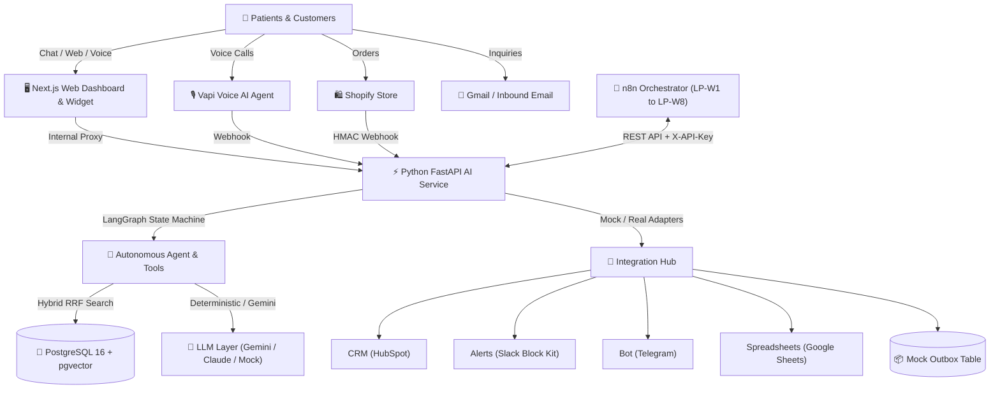
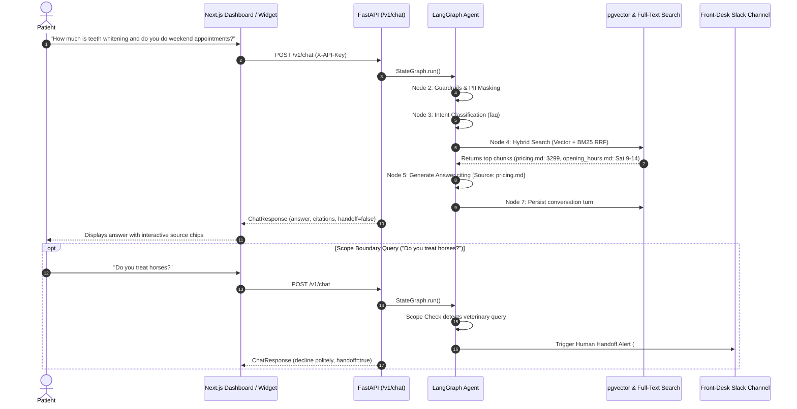
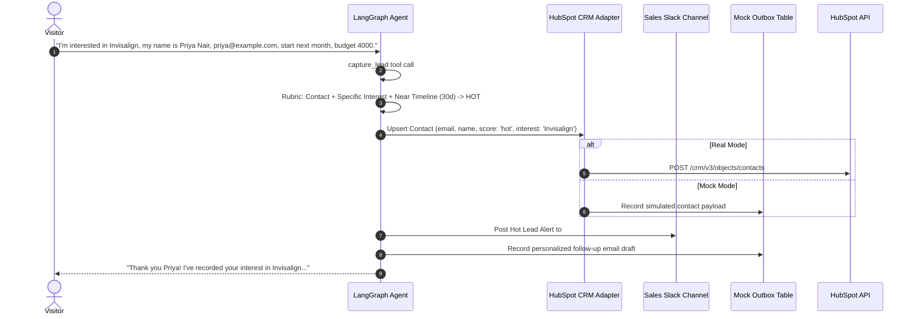
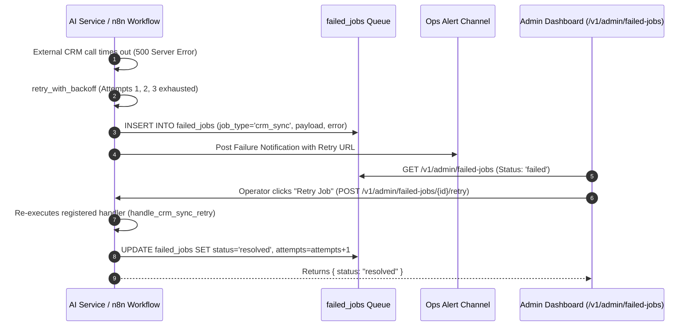

# LeadPilot AI — System Architecture & Design Specification

## 1. System Overview

**LeadPilot AI** is an enterprise-grade virtual operations hub designed for local businesses (demonstrated for **BrightSmile Dental**). It functions as an autonomous front-desk, marketing, and operational team by unifying real-time chat, lead qualification, email triage, optical document audit, voice AI, and multi-channel workflows.

---

## 2. Sequence Diagrams for Core Scenarios

### Scenario A: Grounded Support Chat with RAG & Scope Handoff

### Scenario B: Lead Qualification, Scoring, and CRM Sync

### Scenario G: Workflow Failure Handling & Automatic Retries

---

## 3. Data Model

```mermaid
erDiagram
    TENANTS ||--o{ KB_DOCUMENTS : owns
    TENANTS ||--o{ CONVERSATIONS : participates
    TENANTS ||--o{ LEADS : captures
    TENANTS ||--o{ EMAILS : triages
    TENANTS ||--o{ EXTRACTED_DOCUMENTS : audits
    TENANTS ||--o{ ORDERS : records
    TENANTS ||--o{ CALL_LOGS : logs

    KB_DOCUMENTS ||--|{ KB_CHUNKS : splits_into
    CONVERSATIONS ||--|{ MESSAGES : contains
    LEADS }o--|| CONVERSATIONS : references

    TENANTS {
        uuid id PK
        string name
        string slug
        jsonb settings
    }
    KB_CHUNKS {
        uuid id PK
        uuid document_id FK
        text content
        vector embedding
        tsvector tsv
        jsonb metadata
    }
    LEADS {
        uuid id PK
        uuid tenant_id FK
        string name
        string email
        string phone
        string interest
        string score
        string score_reason
        string crm_id
    }
    EMAILS {
        uuid id PK
        string message_id
        string category
        string priority
        text draft_reply
        string action
    }
    FAILED_JOBS {
        uuid id PK
        string job_type
        jsonb payload
        text error
        int attempts
        string status
    }
```

---

## 4. Design Decisions & Trade-Offs

| Decision | Rationale | Alternatives Considered |
|---|---|---|
| **n8n + Python Hybrid** | Python excels at mathematical validation, vector search, and agent state machines. n8n provides visual orchestration, cron schedules, and webhooks that business clients can understand. | Pure Python (lacks visual UI) or pure n8n (weak native vector and agent control). |
| **pgvector + SQLite Fallback** | PostgreSQL 16 + pgvector is standard for Supabase and production cloud. The dual SQLite/Postgres async driver allows developers to test zero-dependency offline without Docker running. | Chroma / Pinecone (requires cloud network or heavy binaries). |
| **Mock-First Architecture** | Every external integration has an active toggle (`REAL` vs `MOCK`). This prevents tests from ever breaking due to missing third-party API keys or rate limits. | Stubs in unit tests only (leaves end-to-end stack untested). |
| **Reciprocal Rank Fusion (RRF)** | Fusing vector cosine similarity with lexical BM25 matching overcomes vector blindspots on specific numeric pricing ($299) and exact terms. | Dense vector search alone (prone to hallucinating exact pricing). |

---

## 5. Security & Threat Mitigation

| Threat | Risk Level | Mitigation in LeadPilot AI |
|---|:---:|---|
| **Prompt Injection** | High | User content placed in clear data blocks; system prompt enforces strict clinical scope; guardrails block injection phrases. |
| **Webhook Spoofing** | High | Shopify HMAC-SHA256 signature checked using constant-time comparison (`secrets.compare_digest`); Vapi secret header verified. |
| **PII & Card Leakage** | High | Pre-storage regex scrubbing masks credit cards (13-19 digits) and SSNs before messages are saved to database. |
| **Tenant Data Leakage** | High | All queries strictly filter by `tenant_id` at the database index layer. |
| **Secret Exposure** | High | API keys restricted to backend proxy; Next.js server proxy forwards requests; `.env` is git-ignored. |
