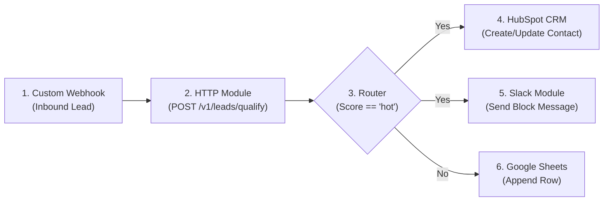

# LeadPilot AI — Make.com & Zapier Integration Guide

LeadPilot AI is engineered with an open REST API and standard JSON contracts. While n8n is our primary self-hosted orchestrator, the backend is 100% compatible with **Make.com** and **Zapier**.

---

## 1. Universal Webhook Contracts

| Endpoint | Method | Headers | Input Body | Output Schema |
|---|---|---|---|---|
| `https://api.yourclinic.com/v1/chat` | `POST` | `X-API-Key: <key>` | `{"message": str, "channel": "web"}` | `{"answer": str, "citations": list, "lead_captured": obj, "handoff": bool}` |
| `https://api.yourclinic.com/v1/leads/qualify` | `POST` | `X-API-Key: <key>` | `{"text": str}` | `{"name": str, "email": str, "score": "hot"|"warm"|"cold", "next_best_action": str}` |
| `https://api.yourclinic.com/v1/emails/triage` | `POST` | `X-API-Key: <key>` | `{"message_id": str, "from_addr": str, "subject": str, "body": str}` | `{"category": str, "priority": str, "draft_reply": str, "needs_human": bool}` |
| `https://api.yourclinic.com/v1/documents/extract` | `POST` | `X-API-Key: <key>` | `multipart/form-data (file)` | `{"vendor_name": str, "subtotal": float, "tax": float, "total": float, "confidence": float}` |

---

## 2. Rebuilding Lead Qualification in Make.com

To replicate our **LP-W2 Lead Processing** flow inside Make.com:



### Step-by-Step Configuration:
1. **Module 1 (Custom Webhook):** Add a *Webhooks -> Custom webhook* module to listen for web form submissions.
2. **Module 2 (HTTP Make a Request):**
   - **URL:** `https://your-leadpilot-host:8000/v1/leads/qualify`
   - **Method:** `POST`
   - **Headers:**
     - Name: `X-API-Key`, Value: `lp_secret_key_demo_2026`
     - Name: `Content-Type`, Value: `application/json`
   - **Body type:** Raw -> JSON -> `{"text": "{{1.message_text}}"}`
3. **Module 3 (Router):**
   - Branch A Filter: Condition `{{2.data.score}} Equal to hot`
4. **Module 4 (HubSpot CRM):** Select *Create a Contact*, mapping `{{2.data.email}}`, `{{2.data.name}}`, and setting custom property `lead_score = {{2.data.score}}`.
5. **Module 5 (Slack):** Send message to `#sales-leads`: `🔥 Hot Lead Captured: {{2.data.name}} - Next Action: {{2.data.next_best_action}}`.

---

## 3. Rebuilding Lead Qualification in Zapier

1. **Trigger:** *Webhooks by Zapier* -> *Catch Hook*.
2. **Action 1 (Webhooks by Zapier):**
   - Event: *Custom Request*
   - Method: `POST`
   - URL: `https://your-leadpilot-host:8000/v1/leads/qualify`
   - Data: `{"text": "{Step 1: Patient Inquiry Text}"}`
   - Headers: `X-API-Key: lp_secret_key_demo_2026`, `Content-Type: application/json`
3. **Action 2 (Filter by Zapier):**
   - Only continue if: `Step 2: score` *Exactly matches* `hot`
4. **Action 3 (HubSpot):**
   - Action: *Create or Update Contact* -> Map fields from Step 2.
5. **Action 4 (Slack):**
   - Action: *Send Channel Message* -> Post formatted alert to `#sales-leads`.

---

## 4. Make.com Blueprint Export Snippet

```json
{
  "name": "LeadPilot - Lead Qualification Flow",
  "flow": [
    {
      "id": 1,
      "module": "gateway:CustomWebHook",
      "version": 1
    },
    {
      "id": 2,
      "module": "http:ActionSendRequest",
      "version": 3,
      "parameters": {
        "url": "http://ai-service:8000/v1/leads/qualify",
        "method": "POST",
        "headers": [
          {"name": "X-API-Key", "value": "lp_secret_key_demo_2026"}
        ]
      }
    }
  ]
}
```
